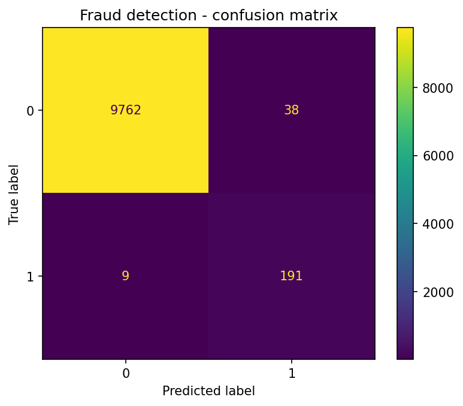

# Credit Card Fraud Detection with a Neural Network

A small end-to-end machine learning project that trains a neural network to flag fraudulent card transactions, then scores new transactions with the saved model.

## Problem
Fraud is rare (about 2% of transactions here), so a model that always says "not fraud" would look 98% accurate while catching nothing. This project focuses on **recall and precision for the fraud class**, not just accuracy.

## Approach
1. **Data:** A synthetic dataset of 50,000 transactions (amount, hour of day, distance from home, transactions in the last 24 hours, online or in-store). No real or private data is used.
2. **Class imbalance:** Fraud cases are oversampled in the training set only, so the test set stays realistic.
3. **Model:** Scikit-learn pipeline with `StandardScaler` and an `MLPClassifier` neural network (two hidden layers: 64 and 32 units, early stopping).
4. **Evaluation:** Precision, recall, F1, ROC-AUC and a confusion matrix on a held-out 20% test set.

## Results (on the synthetic test set)
| Metric | Fraud class |
|---|---|
| Precision | 0.83 |
| Recall | 0.96 |
| F1-score | 0.89 |
| ROC-AUC | 0.999 |



> The data is synthetic and the fraud patterns are deliberately easy to separate, so these scores are higher than a real-world system would reach. The goal is to show the full workflow.

## Project structure
```
fraud-detection-nn/
├── data/              # generated dataset (not uploaded)
├── models/            # saved model (not uploaded)
├── results/           # charts
├── src/
│   ├── generate_data.py
│   ├── train.py
│   └── predict.py
├── requirements.txt
└── README.md
```

## How to run
```bash
git clone https://github.com/<your-username>/fraud-detection-nn.git
cd fraud-detection-nn
python -m venv venv
venv\Scripts\activate        # Windows (Mac/Linux: source venv/bin/activate)
pip install -r requirements.txt

python src/generate_data.py   # creates data/transactions.csv
python src/train.py           # trains, evaluates, saves the model
python src/predict.py         # scores an example transaction
```

## Tools
Python, pandas, NumPy, scikit-learn, matplotlib, joblib

## Possible next steps
- Try gradient boosting (XGBoost) and compare with the neural network
- Tune the decision threshold for the precision/recall trade-off
- Deploy the model as an endpoint on AWS SageMaker
- Add model monitoring for data drift


